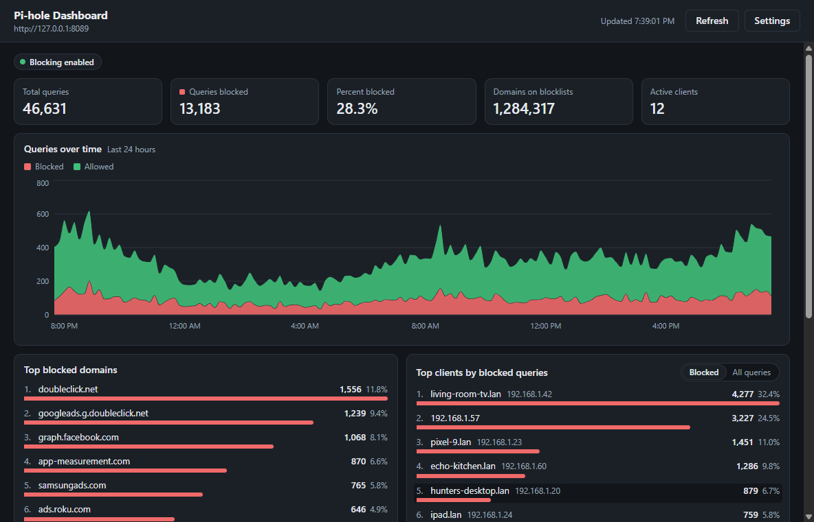

# Pi-hole Dashboard

A Windows desktop widget that signs in to your Pi-hole and shows what it is doing:

- Summary tiles: total queries, queries blocked, percent blocked, domains on blocklists, active clients
- Queries over the last 24 hours, allowed vs. blocked
- Top blocked domains
- Top clients, ranked by blocked queries or by all queries
- Per-client activity over time



Requires **Pi-hole v6 or newer** (it uses the v6 REST API).

## Install

Build the installer (see below) and run `dist/pihole-dashboard-setup-<version>.exe`. The installer is not code-signed, so Windows SmartScreen will warn on first run.

On first start, enter your Pi-hole address (for example `http://pi.hole`) and password. If your Pi-hole has two-factor authentication turned on, create an app password in its web interface and use that.

## Desktop widget

The dashboard is a frameless widget that sits on the desktop, behind your other windows, and stays there through Show Desktop (Win+D). Drag it by its header, resize it from its edges; it reopens where you left it.

The **⋯** button in the header and the tray icon open the same menu:

- **Bring to front** – show the widget above everything until you click elsewhere (clicking the tray icon does the same)
- **Pin to desktop** – untick to make it an ordinary floating window with a taskbar button
- **Start with Windows** – installed builds only
- **Quit**

## Development

Requires Node.js 22.18 or newer.

```
npm install
npm run dev        # run the app with hot reload
npm test           # unit tests
npm run typecheck
npm run mock       # mock Pi-hole on http://127.0.0.1:8089, password "test-password"
npm run dist       # build the Windows installer into dist/
```

To try the app without a real Pi-hole, run `npm run mock` and connect to `http://127.0.0.1:8089`.

## How it works

| Path | Role |
|---|---|
| `src/shared/contract.ts` | Types shared by every layer, and the IPC channel names |
| `src/main/pihole/` | Pi-hole v6 API client: login, session reuse, error mapping, normalisation |
| `src/main/settings.ts` | Settings storage; the password is encrypted with Windows DPAPI |
| `src/main/desktopPin.ts` | Keeps the window just above the desktop layer (user32 calls through koffi) |
| `src/main/windowState.ts` | Remembers the widget's position, size and pinned state |
| `src/main/ipc.ts` | IPC handlers; keeps one Pi-hole session alive across refreshes |
| `src/preload/` | Exposes `window.pihole` to the renderer |
| `src/renderer/src/app/` | App shell, settings screen, polling |
| `src/renderer/src/dashboard/` | Tiles and charts (Recharts) |
| `tests/mock-pihole/` | Mock Pi-hole v6 server used by tests and for demos |

All Pi-hole requests are made from the main process. The password never reaches the renderer and is never written to disk in plain text. Settings live in `settings.json` in the app's folder under `%APPDATA%`, next to `window-state.json`.
